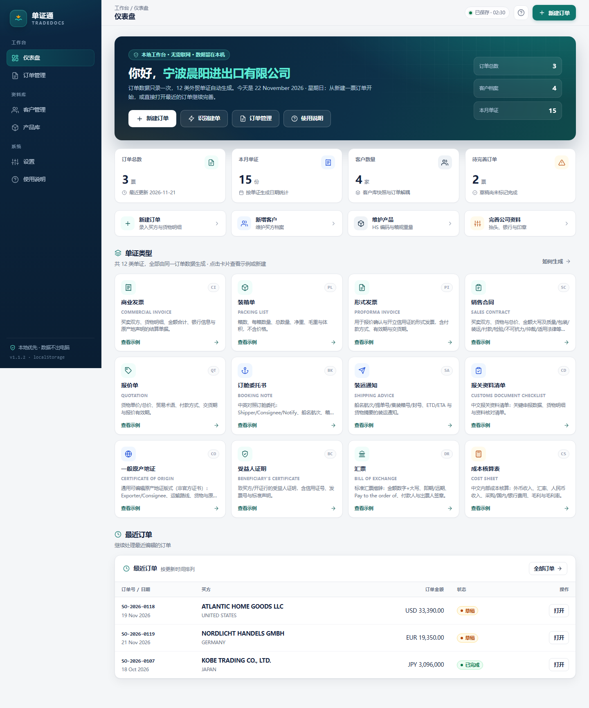
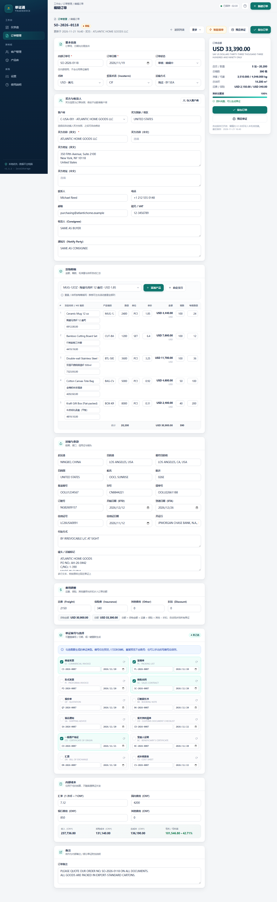
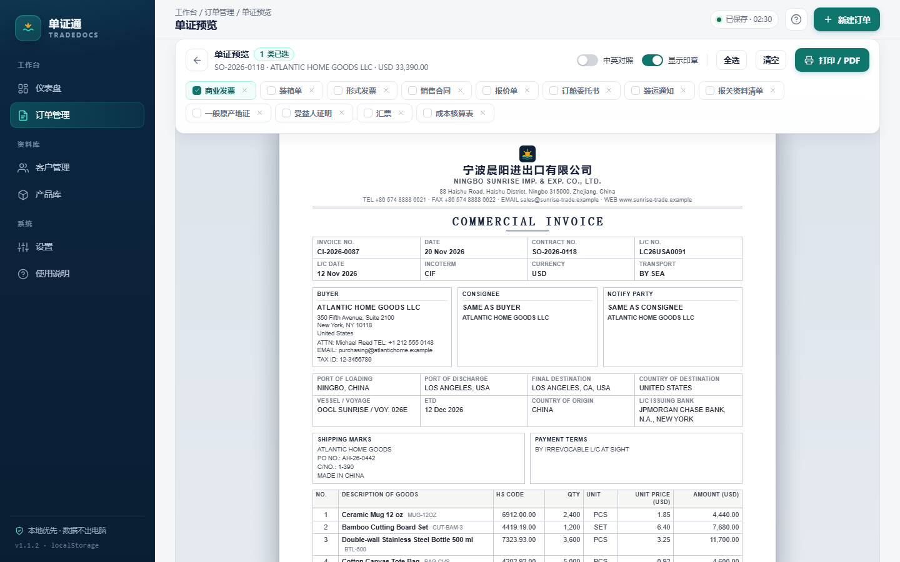
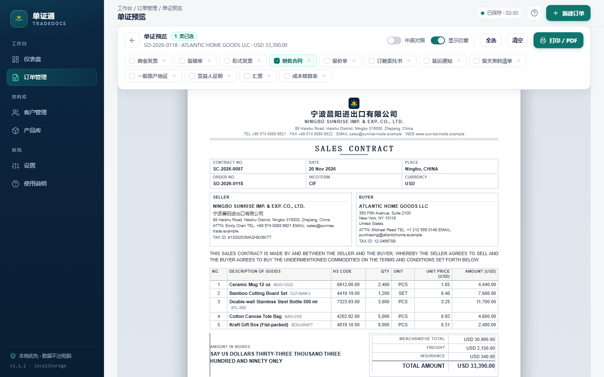
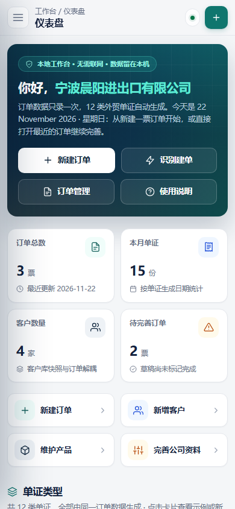
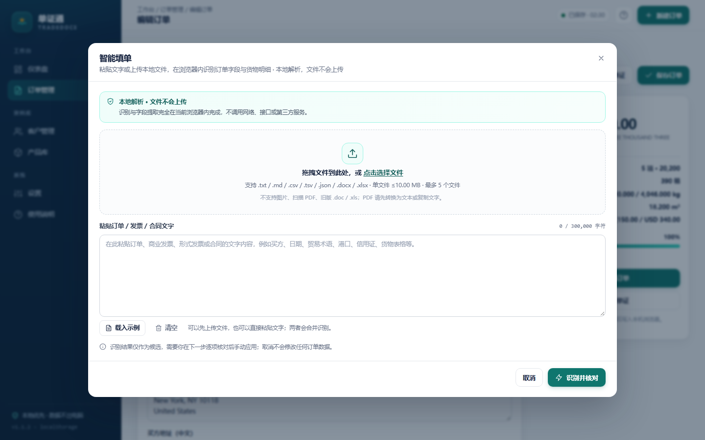
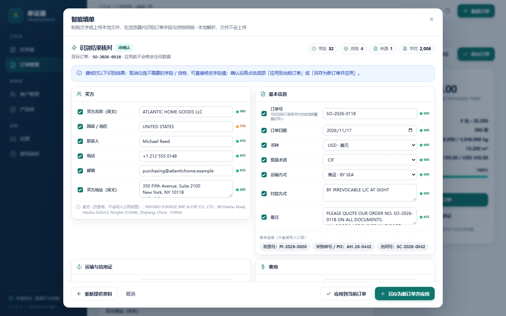

# 单证通 TradeDocs · 外贸单证工作台

一套**免部署、零后端、数据留在本机**的外贸单证 Web 系统。录入一张订单，一键生成整套出口单证，浏览器打印/另存 PDF 即可发给客户、货代或报关行。

v1.1 新增**本地智能填单**：粘贴邮件/订单文字，或上传 TXT、Word、Excel、CSV，自动识别买方、港口、贸易术语、信用证和货物明细，核对后一键填入订单。文件只在浏览器本地解析，不上传。

v1.1.1 对 12 类单证做了**中文商务风格版式重设计**：公司抬头居中、中文名主视觉、宋体标题、统一字号与行距、浅灰表头、细线分隔与更舒展的留白，整体更简约；单证页数与内容不变。

v1.1.2 按业务要求**商业发票（CI）不再展示银行账户信息**；银行信息仍保留在形式发票、汇票等需要收款的单证中。

> 打开即用，不需要安装、不需要服务器、不需要登录，也不会上传任何业务数据。

> **在线使用**：<https://joyzqj.github.io/tradedocs/> · **源码仓库**：<https://github.com/joyzqj/tradedocs>  
> 也可以下载仓库中的单文件版 `dist/单证通-外贸单证系统.html` 离线使用。



---

## 1. 立即使用

### 方式 A：单文件版（推荐，可发给同事）

双击打开：

```
dist\单证通-外贸单证系统.html
```

整个系统只有这一个 HTML 文件，可拷到 U 盘、微信/邮件发送、放共享盘，或上传到任意静态托管；断网也能用。

也可以双击根目录的 `打开单证通.cmd`，它会优先打开单文件版（不存在时打开源码版）。

### 方式 B：源码目录版

双击打开：

```
index.html
```

源码目录无需构建即可运行，适合后续修改。目录里所有 CSS/JS 都是普通静态文件。

> 数据保存在**当前浏览器**的 `localStorage` 中（按浏览器 + 文件地址隔离）。换电脑、换浏览器、清理浏览器数据都不会自动同步数据；请定期在「系统设置 → 数据备份」导出 JSON。

---

## 2. 能做什么

### 一张订单，驱动 12 类单证

| 单证 | 英文 | 典型用途 |
|---|---|---|
| 商业发票 | COMMERCIAL INVOICE | 报关、结汇、客户清关 |
| 装箱单 | PACKING LIST | 报关、货代订舱、客户验收 |
| 形式发票 | PROFORMA INVOICE | 报价确认、开信用证、预收货款 |
| 销售合同 | SALES CONTRACT | 正式成交、条款约定 |
| 报价单 | QUOTATION | 客户询价回复 |
| 订舱委托书 | BOOKING NOTE | 向货代订舱 |
| 装运通知 | SHIPPING ADVICE | 开船后通知买方 |
| 报关资料清单 | CUSTOMS DOCUMENT CHECKLIST | 给报关行/内部核对 |
| 一般原产地证 | CERTIFICATE OF ORIGIN | 客户清关、关税优惠（通用版式） |
| 受益人证明 | BENEFICIARY'S CERTIFICATE | 信用证交单 |
| 汇票 | BILL OF EXCHANGE | 信用证/托收项下收款 |
| 成本核算表 | COST SHEET | 内部核算毛利、报价决策 |

### 核心能力

- **订单即数据源**：买方、货物、港口、条款只填一次，所有单证共用；改数量/单价，金额、箱数、毛净重、体积、英文大写金额同步更新。
- **一键成套**：勾选需要的单证，统一编号（如 `CI-2026-0087`），一键连续打印或另存为一个 PDF。
- **专业 A4 版式**：公司抬头、logo、印章、银行信息（形式发票等）、签章栏、页脚齐全；长表格自动重复表头、分页不截断。
- **中英对照**：单证默认英文，可切换关键字段中英对照。
- **客户库 / 产品库**：常用买方、HS 编码、包装、每箱重量体积一次维护，开单直接带出。
- **编号与备份**：每种单证独立流水号，可自定义前缀规则；JSON 一键备份/恢复，支持多台电脑迁移。
- **本地优先**：无账号、无后端、无网络请求，报价和客户资料不出本机。
- **智能填单（v1.1）**：粘贴文字或上传 Word/Excel/TXT/CSV，本地规则识别买方、单证号、日期、贸易术语、付款、港口、ETD/ETA、信用证、船名航次、唛头、费用与货物明细；带置信度和原文证据，核对后一键填入当前订单或另存为新订单。

### 智能填单怎么用

订单编辑页点 **「智能填单」**（或在仪表盘/订单页点「识别建单」）：

1. 拖入/选择文件（`.txt/.md/.csv/.tsv/.json/.docx/.xlsx`，单文件 ≤10MB，最多 5 个），或直接粘贴发票/合同/邮件文字；也可以点「载入示例」。
2. 点「识别并核对」，系统在本地提取文字与表格，给出买方、基本信息、运输与信用证、费用、货物明细候选；每项可勾选、直接修改，并显示置信度与原文依据。
3. 选择「仅填充空白字段 / 覆盖识别字段」「追加货物 / 替换货物」，再点「应用到当前订单」或「另存为新订单并应用」。**应用前不会修改任何数据。**

可直接试用 `samples/智能识别示例/` 中的文本、Word、Excel 示例文件。

> 边界：当前版本**不做图片 OCR、扫描 PDF、旧版 .doc/.xls，也不调用任何 AI 接口**；纯文本型 PDF 同样暂不支持。识别为规则匹配，准确率取决于源文件排版，结果仅作为候选，请务必人工核对后再应用。

> 版式参考：CI / PL / PI / QT / BK / SA / CD / CO / BC / DR / CS 各一页 A4，销售合同（SC）为两页 A4；整套连续打印会自动分页、长表格重复表头，末尾不会多出空白页。成品效果见 `samples/`：`单证通-演示订单单证合集.pdf`（常选 4 类，5 页）、`单证通-12类单证全套示例.pdf`（全套，13 页）、`单证通-销售合同两页示例.pdf`。

### 界面一览

| 订单编辑 | 商业发票预览 |
|---|---|
|  |  |

| 销售合同预览 | 移动端 |
|---|---|
|  |  |

| 智能填单：上传/粘贴 | 识别结果核对 |
|---|---|
|  |  |

---

## 3. 五分钟做一套单证

1. **首次进入**：系统已带一套演示订单（买方 ATLANTIC HOME GOODS），可直接在「订单管理 → 打开」里体验，也可先看 `samples/单证通-演示订单单证合集.pdf` 了解成品效果；正式使用前到「系统设置」把公司资料、银行信息换成自己的，并在「数据备份」里清空演示数据（或保留作模板，直接改）。
2. **新建订单**：点「新建订单」，选择客户库中的买方（或手填），填写贸易术语、付款方式、起运港/目的港、船名航次、信用证号等。已有 PI/PO/合同/装箱单文件时，可点「智能填单」先识别，再核对补全。
3. **添加货物**：从产品库添加，或直接新增行；填写数量、单价、箱数/每箱数量、每箱毛净重和体积。金额、合计、英文大写自动计算。
4. **生成单证**：在订单页点「预览单证」，勾选需要的单证类型，系统自动编号；检查 A4 预览。
5. **打印 / PDF**：点「打印」，在浏览器打印对话框选择「另存为 PDF」；建议设置见下方。

### 打印为 PDF 的建议设置

| 项目 | 设置 |
|---|---|
| 目标打印机 | 另存为 PDF / Microsoft Print to PDF |
| 纸张 | A4 |
| 边距 | 无 / 默认 |
| 缩放 | 100%（不要“适合页面”） |
| 背景图形 | **开启**（否则印章、底色/线条可能丢失） |
| 页眉页脚 | 关闭 |
| 份数 | 1 份，可多页连续 |

> 若打印出来是空白、多出空白页或样式错位：确认纸张为 A4、缩放 100%、勾选“背景图形”，并尽量使用 Chrome / Edge 最新版。预览区看到的效果就是打印效果。

---

## 4. 数据、隐私与备份

- 数据存在浏览器 `localStorage`，键名 `tradedocs.v1`。**不上传服务器**，也不会自动同步到其他电脑。
- 换电脑 / 换浏览器 / 清理浏览器缓存前，请在「系统设置 → 数据备份 → 导出备份」保存 JSON。
- 恢复时导入同一份 JSON 即可。导入会覆盖当前全部数据，系统会二次确认。
- 单文件版与源码目录版在**同一个浏览器**里通常共用数据；但移动文件、换浏览器都可能造成看不到旧数据，重要资料请以 JSON 备份 + PDF 存档为准。
- 演示数据中的公司、客户、银行、地址均为虚构示例，请全部替换后再对外使用。

---

## 5. 自定义与二次开发

### 公司资料

「系统设置 → 公司资料」可设置中英文公司名、地址、电话、邮箱、税号、签字人/职务，并上传 logo、公章/业务章图片（建议 PNG 透明底，≤300KB）。银行信息用于形式发票、汇票等需要收款的单证；商业发票（CI）按当前业务要求不展示银行账户信息。

### 单证编号

在「系统设置 → 编号规则」设置每种单证的下一个流水号和补零位数。编号在首次生成/预览时消耗；重复预览不会跳号。格式为 `前缀-年份-流水号`。

### 项目结构

```
trade-docs/
├─ index.html                 应用入口
├─ css/
│  ├─ app.css                 界面样式
│  └─ print.css               A4 单证样式 + 打印规则
├─ js/
│  ├─ core.js                 金额、大写、日期、计算、校验等纯函数
│  ├─ demo.js                 演示数据
│  ├─ recognize.js            本地智能识别：文本/CSV/Word/Excel 提取与规则解析
│  ├─ doc-templates.js        12 类单证模板（纯函数）
│  ├─ store.js                本地存储、编号、备份
│  └─ app.js                  路由与界面交互
├─ docs/CONTRACT.md           模块接口与数据模型契约
├─ tests/                     Node 单元/模板/Chrome E2E 测试
├─ screenshots/               产品界面截图
├─ samples/                   PDF 成品 + 智能识别示例（txt/docx/xlsx）
├─ 打开单证通.cmd              Windows 快速启动（优先单文件版）
├─ build_single_file.py       单文件打包脚本
└─ dist/                      单文件产物（可独立分发）
```

### 修改后重新打包单文件

```powershell
cd trade-docs
python build_single_file.py
# 产物：dist/单证通-外贸单证系统.html
```

源码不需要 npm / webpack / 构建步骤；改完 CSS/JS 刷新浏览器即可。所有模块通过 `window.TradeDocs` 协作，接口见 `docs/CONTRACT.md`。

### 运行测试

```powershell
cd trade-docs
node tests/test-core.mjs          # 119 项核心计算/金额大写/校验测试
node tests/test-templates.mjs     # 47 项 12 类单证内容/转义/纯函数测试
node tests/test-recognize.mjs     # 48 项智能识别解析/提取/apply 测试
node tests/e2e.mjs --full         # 56 项 Chrome 集成测试（含识别/建单流程）；需本机安装 Chrome
```

质量基线（v1.1.2）：核心 119/119、模板 47/47、识别 48/48、集成 56/56 全绿；打印矩阵为核心单证各 1 页 A4、销售合同 2 页、全套 13 页，无末尾空白页；公司抬头居中、模块字距/行距统一；商业发票不展示银行账户信息；XSS、徽标/印章上传、JSON 备份恢复、智能识别文件上传与新建订单流程、移动端 390px 均已覆盖。详见 `tests/QA_REPORT.md`。

---

## 6. 重要说明与边界

- 本系统的「一般原产地证」是**通用可编辑版式**，用于内部起草和资料准备；正式 CO 须通过中国贸促会（CCPIT）或海关等签发机构的正规系统办理，以其格式和盖章为准。
- 报关单、核销单、许可证等**官方单据不在本系统生成范围**；本系统生成的是随附商业单证和内部核对资料。
- 单证内容（HS 编码、品名、金额、贸易术语、原产地、收货人信息等）的准确性、合规性由使用人负责；正式交单前请按合同/信用证和目的国要求人工复核。
- 系统不提供法律、税务、报关或信用证审单意见。
- 演示数据和示例公司仅用于功能展示，与任何真实企业无关。
- 浏览器建议：Chrome / Edge 100+、Safari 15.4+、Firefox 100+。IE 不支持。

---

**版本**：1.1.2 · **形态**：纯静态单页应用 · **数据**：本机 localStorage · **依赖**：无

如需把单证模板换成贵司固定抬头、增加产品字段或对接内部系统，可从 `js/doc-templates.js` 与 `docs/CONTRACT.md` 入手。智能识别的规则与格式扩展见 `js/recognize.js` 与 `docs/CONTRACT.md §13`。
